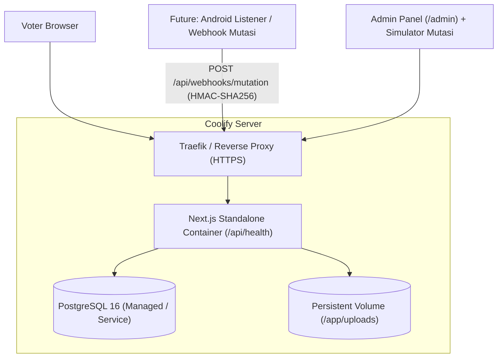

# Rancangan & Rencana Implementasi Website Voting Berbasis QRIS Statis (PostgreSQL + Coolify)

## Goal Description

Merancang dan membangun aplikasi web voting berbayar di `D:\Vote Static` menggunakan **Next.js (App Router, TypeScript) + PostgreSQL + Prisma** yang siap di-deploy ke **Coolify**. Pembayaran setiap vote menggunakan **QRIS Statis** dengan mekanisme **Nominal Unik (3 digit terakhir)**, **Generic Webhook Mutasi (HMAC-SHA256)** yang siap disambungkan ke listener/aggregator kapan saja, **Simulator Mutasi** untuk pengujian, serta **Rekonsiliasi Manual** yang teraudit.

---

## User Review Required

> [!IMPORTANT]
> **Penyesuaian Deployment Coolify & Operasional:**
> 
> 1. **Next.js Standalone + Dockerfile:** Aplikasi dikonfigurasi dengan `output: "standalone"` dan `Dockerfile` multi-stage agar build di Coolify ringan, cepat, dan menjalankan `npx prisma migrate deploy` otomatis sebelum server menyala.
> 2. **Persistent Volume untuk Gambar:** Karena container Coolify bersifat *ephemeral* saat redeploy, gambar QRIS Statis, foto kandidat, dan bukti transfer akan disimpan di direktori `/app/uploads` (disajikan via route `/api/files/[...path]`) yang wajib di-mount sebagai **Persistent Storage** di dashboard Coolify.
> 3. **Belum Ada Integrasi Mutasi Eksternal:** Endpoint `POST /api/webhooks/mutation` dibuat dengan format standar bertanda tangan HMAC-SHA256. Sebelum listener terpasang, panitia tetap dapat menguji alur otomatis via **Simulator Mutasi** di `/admin`, atau memvalidasi transfer melalui **Rekonsiliasi Manual**.

> [!WARNING]
> **Aturan Teknis QRIS Statis & PostgreSQL:**
> 
> - Harga minimal 1 vote ditetapkan **≥ Rp1.000** agar rentang kode unik (`001–999`) tidak bertabrakan dengan kelipatan harga paket vote.
> - Saat nanti menghubungkan listener mutasi (mis. Android Notification Listener / Moota / CekMutasi), pastikan sumbernya membaca **nominal bruto pembayaran pelanggan**, bukan mutasi settlement rekening yang terpotong MDR.

---

## Arsitektur & Alur Sistem (Siap Coolify)



---

## Proposed Changes

Seluruh proyek akan diinisialisasi di `D:\Vote Static` dan dikelompokkan per komponen:

### 1. Infrastruktur Deployment (Coolify & Local Dev)

#### [NEW] `Dockerfile` & `.dockerignore`

- Multi-stage build (`deps` → `builder` → `runner` berbasis `node:20-alpine`).
- Menyalin hasil `.next/standalone`, `.next/static`, dan folder `prisma/`.
- Entrypoint script menjalankan `npx prisma migrate deploy` lalu `node server.js`.

#### [NEW] `docker-compose.yml`

- Khusus pengembangan lokal di Windows: menjalankan service `postgres:16-alpine` (port `5432`) dengan volume data lokal agar sesuai dengan lingkungan produksi Coolify.

#### [NEW] `next.config.ts` & `.env.example`

- Mengaktifkan `output: "standalone"` di `next.config.ts`.
- Mendokumentasikan environment variables untuk Coolify:
  - `DATABASE_URL`
  - `WEBHOOK_SECRET` (kunci HMAC-SHA256 untuk mutasi masuk)
  - `ADMIN_PASSWORD` & `AUTH_SECRET` (proteksi sesi dashboard admin)
  - `UPLOAD_DIR=/app/uploads`

#### [NEW] `src/app/api/health/route.ts`

- Healthcheck endpoint untuk Coolify: mengeksekusi `SELECT 1` ke PostgreSQL dan mengembalikan HTTP `200 OK` (atau `503` jika DB belum siap).

---

### 2. Skema PostgreSQL & Integritas Transaksi (Prisma)

#### [NEW] `prisma/schema.prisma` & Custom SQL Migration

Model inti:

- `Event`: `id`, `slug`, `title`, `pricePerVote`, `qrisImagePath`, `qrisRawPayload`, `startsAt`, `endsAt`, `orderCutoffMinutes`, `isBlindMode`, `isActive`
- `Candidate`: `id`, `eventId`, `number`, `name`, `photoPath`, `description`, `totalVotes`
- `VoteOrder`: `id`, `eventId`, `candidateId`, `voterName`, `voterContact`, `sessionKey`, `voteQty`, `baseAmount`, `uniqueCode`, `totalAmount`, `status` (`PENDING` | `PAID` | `EXPIRED` | `LATE_PAYMENT` | `CANCELLED`), `expiresAt`, `paidAt`, `createdAt`
- `PaymentMutation`: `id`, `eventId`, `amount`, `rrn` (`@unique`), `rawMessage`, `source`, `status` (`MATCHED` | `UNMATCHED` | `DUPLICATE`), `matchedOrderId`, `transactionAt`, `receivedAt`
- `VoteLedger`: `id`, `orderId` (`@unique`), `candidateId`, `voteQty`, `recordedAt` *(immutable append-only ledger)*
- `ManualProof`: `id`, `orderId`, `imagePath`, `imageHash` (`@unique`), `rrnInput`, `status` (`PENDING_REVIEW` | `APPROVED` | `REJECTED`), `reviewedBy`, `createdAt`
- `AuditLog`: `id`, `actor`, `action`, `targetId`, `metadata`, `createdAt`
- `ListenerHeartbeat`: `id`, `deviceName`, `lastPingAt`, `status`

> [!NOTE]
> **Partial Unique Index di PostgreSQL:**
> Migrasi SQL akan menyertakan:
> 
> ```sql
> CREATE UNIQUE INDEX "uniq_pending_order_amount"
> ON "VoteOrder" ("eventId", "totalAmount")
> WHERE "status" = 'PENDING';
> ```
> 
> Menjamin di level database bahwa dua voter bersamaan tidak pernah mendapat `totalAmount` yang sama.

---

### 3. Core Logic: QRIS Statis, Kode Unik & Settlement Atomik

#### [NEW] `src/lib/qris.ts`

- Parser payload EMVCo TLV dari `qrisRawPayload`.
- Injeksi Tag `54` (Transaction Amount) + kalkulasi ulang CRC16-CCITT (`Tag 63`) untuk menghasilkan QR dinamis-nominal dari QRIS Statis, lengkap dengan fallback ke gambar QRIS statis asli.

#### [NEW] `src/lib/unique-code.ts`

- Validasi cutoff waktu (`now <= event.endsAt - orderCutoffMinutes`) dan `expiresAt = Math.min(now + 15m, event.endsAt)`.
- Idempotent checkout per `sessionKey` (mencegah spam kode unik oleh user yang sama).
- Alokasi `uniqueCode` (`1..999`) dengan strategi **LRU** dan **masa karantina 45 menit** setelah order `EXPIRED` untuk mencegah *vote hijacking* akibat pembayaran telat.

#### [NEW] `src/lib/webhook-security.ts` & `src/lib/settlement.ts`

- Verifikasi `X-Signature` (HMAC-SHA256) dan `X-Timestamp` (±60 detik).
- `settleOrderInTransaction(orderId, mutationId?)`:
  - `UPDATE VoteOrder SET status = 'PAID', paidAt = now() WHERE id = $1 AND status = 'PENDING'` (atomik, anti *double-counting*).
  - Insert `VoteLedger` (`UNIQUE(orderId)`).
  - Increment `Candidate.totalVotes`.

---

### 4. API Routes & Admin Protection

#### [NEW] Publik & Voter API

- `GET /api/events/[slug]` — Detail event, kandidat, dan leaderboard (menghormati `isBlindMode`).
- `POST /api/orders` — Rate-limited checkout + alokasi kode unik.
- `GET /api/orders/[id]` & `DELETE /api/orders/[id]` — Polling status pembayaran & pembatalan sukarela.
- `POST /api/orders/[id]/proof` — Unggah bukti bayar manual (dengan cek duplikasi `imageHash` SHA-256) saat belum ada listener otomatis.
- `GET /api/files/[...path]` — Menyajikan gambar dari `UPLOAD_DIR` (`/app/uploads`) secara aman (anti path-traversal).

#### [NEW] Webhook & Admin API (Dilindungi Session Cookie / HMAC)

- `POST /api/webhooks/mutation` & `POST /api/webhooks/heartbeat` — Siap menerima integrasi mutasi di masa depan.
- `POST /api/admin/auth` — Login sederhana berbasis `ADMIN_PASSWORD` (HMAC signed HTTP-only cookie).
- `POST /api/admin/simulate-mutation` — Simulator mutasi internal untuk menguji auto-matching end-to-end tanpa integrasi eksternal.
- `POST /api/admin/reconcile` — *Manual Approve* (wajib menautkan `PaymentMutation` `UNMATCHED` atau memverifikasi `ManualProof` + mencatat `AuditLog`).
- CRUD `events` & `candidates` (termasuk upload gambar QRIS Statis & foto kandidat ke `UPLOAD_DIR`).

---

### 5. Antarmuka Pengguna (Frontend)

#### [NEW] `src/app/page.tsx` & `src/app/events/[slug]/page.tsx`

- Halaman utama voting: informasi event, timer penutupan, daftar kandidat, leaderboard (atau status *Blind Mode*), dan modal pembelian vote.

#### [NEW] `src/app/pay/[orderId]/page.tsx`

- Tampilan QRIS (injeksi Tag `54` + tombol fallback QRIS statis asli), nominal unik dengan *highlight* 3 digit terakhir + tombol salin, timer mundur, polling status otomatis 3 detik, dan form unggah bukti manual.

#### [NEW] `src/app/admin/page.tsx` & `src/app/admin/login/page.tsx`

- Dashboard panitia: ringkasan audit (`Total Dana Masuk` vs `Total Suara × Harga`), status heartbeat listener, manajemen event/kandidat/QRIS, antrean rekonsiliasi & bukti manual, serta **Simulator Mutasi**.

---

## Verification Plan

### Automated Tests

1. **Unit Tests (`vitest`):**
   - `qris.test.ts`: Verifikasi parsing TLV, injeksi Tag `54`, dan CRC16-CCITT Tag `63`.
   - `unique-code.test.ts`: Uji masa karantina 45 menit, LRU ordering, dan anti-tabrakan `totalAmount`.
   - `webhook-security.test.ts`: Uji validasi HMAC-SHA256 & penolakan timestamp kedaluwarsa.
2. **Typecheck & Production Build:**
   - `npx tsc --noEmit && npm run build`
3. **Container Build Verification:**
   - Verifikasi `Dockerfile` valid dan konfigurasi `standalone` menghasilkan `server.js`.

### Manual Verification

1. **Local Docker PostgreSQL + App:**
   - Jalankan `docker compose up -d postgres`, `npx prisma migrate dev`, dan `npm run dev`.
   - Uji `GET /api/health` mengembalikan `200 OK`.
2. **End-to-End Voting & Simulasi Mutasi:**
   - Login ke `/admin`, buat event + upload QRIS statis + tambah 2 kandidat.
   - Checkout 3 vote dari halaman publik → catat nominal unik di `/pay/[orderId]`.
   - Jalankan **Simulator Mutasi** di `/admin` → verifikasi `/pay/[orderId]` otomatis berubah menjadi **Vote Berhasil**, suara bertambah, dan angka audit sinkron.
   - Uji kasus duplikat `rrn` dan unggah bukti manual dengan gambar yang sama (harus ditolak).
